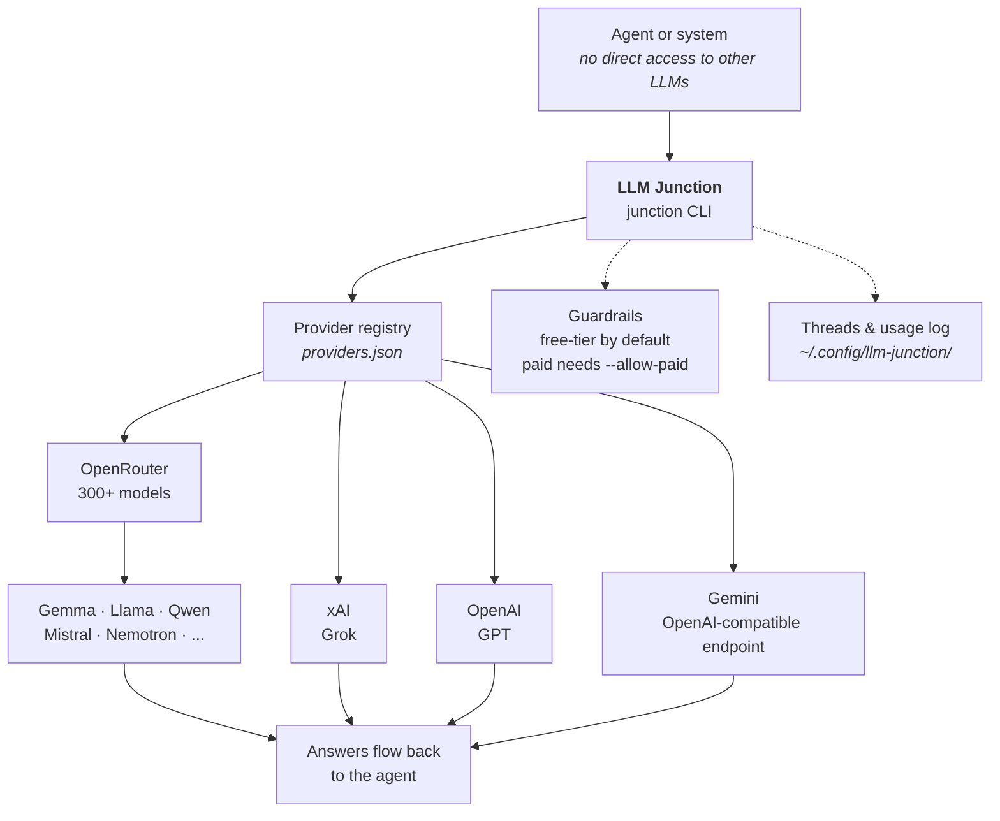

# LLM Junction

A switchboard for talking to other LLMs.

The idea: one agent or system that has no direct access to other LLMs plugs
into the junction, and the junction connects it to whichever models are
plugged in on the other side. Providers are pluggable — OpenRouter ships as
the first one (300+ models through a single key); any OpenAI-compatible API
can be added and is then addressable as `provider::model`.

## How it works



## Setup

No dependencies — Python 3.10+ and the standard library only.

```bash
export OPENROUTER_API_KEY="sk-or-v1-..."   # get one at openrouter.ai/keys
chmod +x junction.py
./junction.py providers
```

## Usage

```bash
# what is plugged in
junction providers

# list models (live from OpenRouter)
junction models --free -q gemma

# ask one model (bare id = default provider)
junction ask google/gemma-3-27b-it:free "Explain covered calls like I'm five"

# let OpenRouter pick an available free model
junction ask openrouter/free "Give me a second opinion on this idea"

# keep a thread going
junction ask openrouter/free "Second opinion please: ..." --thread research
junction thread research "What about the downside risk?"

# ask several models the same thing, compare answers
junction roundtable "Is this a good deal?" \
  --models google/gemma-3-27b-it:free,meta-llama/llama-3.3-70b-instruct:free

# threads and usage
junction threads
junction show research
junction usage
```

## Plugging in another provider

Any OpenAI-compatible chat-completions API works. Add it to
`~/.config/llm-junction/providers.json`:

```json
{
  "default": "openrouter",
  "providers": {
    "openrouter": {
      "base_url": "https://openrouter.ai/api/v1",
      "key_env": "OPENROUTER_API_KEY"
    },
    "xai": {
      "base_url": "https://api.x.ai/v1",
      "key_env": "XAI_API_KEY"
    },
    "gemini": {
      "base_url": "https://generativelanguage.googleapis.com/v1beta/openai",
      "key_env": "GEMINI_API_KEY"
    }
  }
}
```

Then address its models directly:

```bash
export XAI_API_KEY="..."
junction ask xai::grok-4 "Second opinion please" --allow-paid
```

## Free tier (OpenRouter)

OpenRouter's free tier needs no credit card. Models whose IDs end in `:free`
cost nothing: **20 requests/min, 50/day** (rises to 1,000/day after a one-time
$10 credit purchase — you never have to spend it). `openrouter/free` routes to
whichever free model is currently available.

The free bench is open-weight models (Gemma, Llama, Qwen, Mistral, …) and the
lineup churns — list live with `junction models --free` rather than pinning
one forever.

## Guardrails

- Paid models are refused by default. `--allow-paid` opts in per call.
- `usage` shows today's request count against the daily cap (default 50,
  configurable in `~/.config/llm-junction/config.json`).
- Threads persist under `~/.config/llm-junction/threads/`.
- Each provider's key is read from its configured environment variable at
  runtime and never written to disk, logs, or chat.

## Why it exists

Built to give an AI assistant a "phone a friend" line to other models —
second opinions in chat, multi-model eval harnesses, and cost-vs-quality
comparisons across the free bench before spending on flagships.
